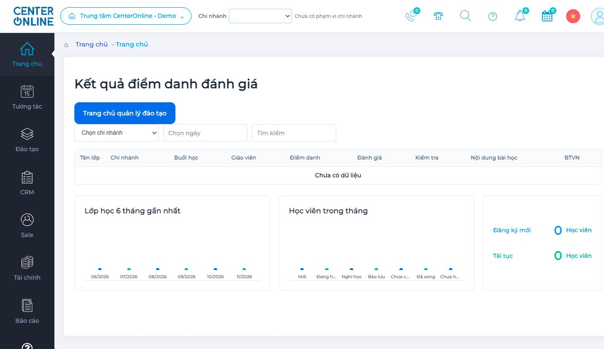

# Center EDU

Ứng dụng quản lý trung tâm giáo dục: theo dõi học viên, giáo viên, lớp học, lịch học và các hoạt động chăm sóc khách hàng trên một giao diện web.



*Trang chủ với dữ liệu trống. Ảnh chụp từ bản chạy thử; giao diện và tính năng đang tiếp tục được hoàn thiện.*

## Các khu vực chính

- **Đào tạo:** học viên, giáo viên, khóa học, lớp học và lịch học.
- **CRM và chăm sóc:** khách hàng tiềm năng, ghi chú và lịch sử chăm sóc.
- **Thiết lập:** chi nhánh, phòng học, ca học và các danh mục của trung tâm.
- **Tổng quan và báo cáo:** theo dõi thông tin hoạt động từ trang chủ.

Một số màn hình và thao tác vẫn đang được kiểm thử và sửa; không phải toàn bộ chức năng đã sẵn sàng cho vận hành thực tế.

## Chạy trên máy

Cần Git và Python 3.9 trở lên. Ứng dụng sử dụng SQLite, không cần cài máy chủ cơ sở dữ liệu riêng.

```bash
git clone https://github.com/NamAIEngineer/center-edu-CLC.git
cd center-edu-CLC
python3 app.py --host 127.0.0.1 --port 8000
```

Mở **http://127.0.0.1:8000/**. Dữ liệu được lưu trong thư mục `data/` trên máy chạy ứng dụng. Việc clone mã nguồn không mang theo dữ liệu của trung tâm khác.

### Khởi tạo cơ sở dữ liệu trống

Để tạo cơ sở dữ liệu mới với tài khoản quản trị, chạy trong terminal:

```bash
export CENTER_EDU_PRODUCTION=1
export CENTER_EDU_ADMIN_PASSWORD='thay-bang-mat-khau-rieng'
python3 app.py --host 127.0.0.1 --port 8000 --db ./data/center-moi.sqlite3
```

Đăng nhập bằng tên `admin` và mật khẩu vừa đặt. Dùng mật khẩu riêng và không đưa mật khẩu hoặc tệp cơ sở dữ liệu lên Git. Trên Windows PowerShell, đặt biến bằng `$env:CENTER_EDU_PRODUCTION = '1'` và `$env:CENTER_EDU_ADMIN_PASSWORD = '...'`.

Sau khi đăng nhập, bắt đầu bằng chi nhánh và các danh mục, rồi thêm nhân sự, khóa học, học viên và lớp học. Các luồng nhập dữ liệu ban đầu đang được rà soát; nếu một thao tác không hoạt động, ghi lại tên trang và ảnh màn hình để kiểm tra.

## Cập nhật bản mới

Nếu đã clone trước đó, kiểm tra và lưu các thay đổi cá nhân trước khi cập nhật:

```bash
git status
git pull origin main
```

Khởi động lại ứng dụng sau khi cập nhật. Việc cập nhật mã không tự thay thế cơ sở dữ liệu đã có; hãy sao lưu dữ liệu trước khi thay đổi môi trường chạy.

## Kiểm thử

```bash
python3 -m unittest discover -s tests -p 'test_*.py'
```

## Trạng thái

Đây là sản phẩm đang tiếp tục hoàn thiện. Một số trang, thao tác và kiểm thử phân quyền chưa được xác minh đầy đủ; cần kiểm thử theo nhu cầu thực tế trước khi bàn giao vận hành.
